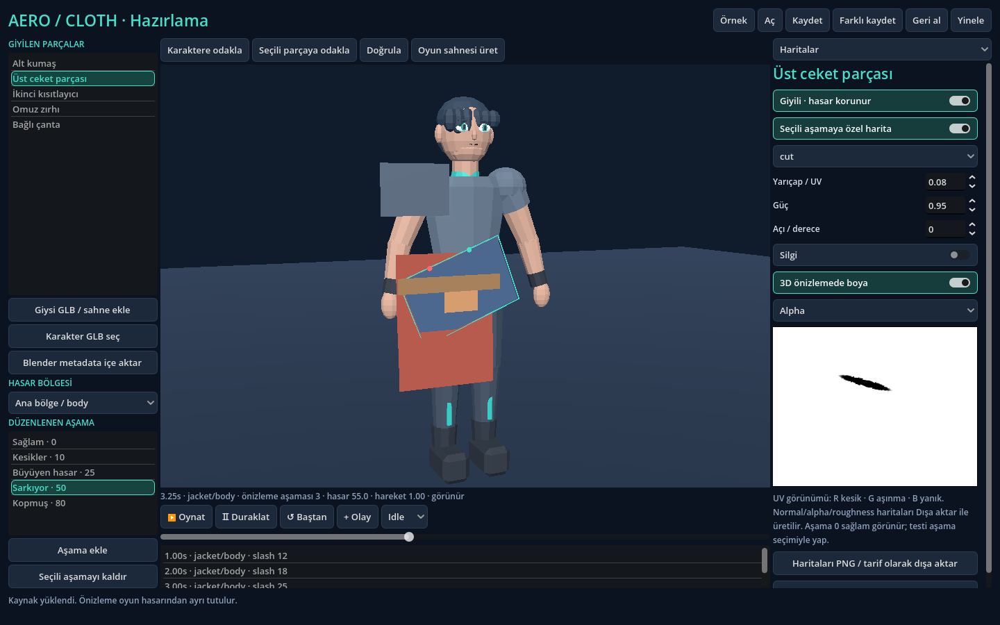

# AeroCloth3D · 0.3 Authoring

Blender'da hazırlanmış karakter ve giysiler için **Godot editörü içinde** hasar,
katman ve hareket hazırlama eklentisi. Ayrı uygulama kurmak gerekmez. F5 ile açılan
çalışma sahnesi ayrıca test/önizleme istemcisidir.



## Başlangıç

1. `project.godot` dosyasını açıp GLB importunun bitmesini bekle.
2. Üst ana ekranlardan **AeroCloth3D**'yi seç. Alternatif: Project → Tools →
   **AeroCloth3D · Open Authoring**. Bu işlem oyunu başlatmaz.
3. **Örnek** ile karakter, alt kumaş, üst parça, ikinci kısıtlayıcı, zırh ve çantayı yükle.
4. Parça/bölge seç. **Haritalar** bölümünde 3D yüzeye veya UV görünümüne boya.
   Kesik, aşınma, yanık, kan, ezik; silgi, yumuşatma, büyütme/küçültme vardır.
5. **Seçili aşamaya özel harita** ile her aşamaya ek izler hazırla. Aşama listesi
   düzenlenen kaynağı, önizleme satırı simüle edilen hasarı gösterir.
6. **Aşamalar** bölümünde eşik, alpha/normal/PBR etkisi, kopacak bağlantılar ve
   hazırlanmış model varyantını ayarla. Sonraki aşamalar önceki haritaları içerir.
7. **Katmanlar** bölümünde üst→alt bölge, hareket sınırı, örtme ve son etkin
   aşamayı düzenle. Üst parça kopunca kalan etkileyicilerin kısıtları korunur.
8. Animasyon oynat; zaman çizgisine darbe ekle veya 3D görünümde darbe dene.
   Geri sarma, başlangıçtan sabit adımla tekrar simüle eder.
9. **Kaydet** hazırlığı `.tres` olarak saklar. **Oyun sahnesi üret**, editör
   bağımlılığı olmayan `AeroWearableRig` sahnesini oluşturur.

Yeni varlıklarda önce **Karakter GLB seç**, ardından **Giysi GLB / sahne ekle**.
**Hazırlama** bölümünde gerçek mesh'i, hareket türünü, kemiği ve gerektiğinde
proxy mesh'i seç. Skinned giysi iskelete, cloth hazırlanmış üçgen proxy'ye,
rigid parça bağlantılara bağlanır. Kaynaklar Inspector'da da düzenlenebilir.

## Oyuna bağlama

Savaş sistemi isabet/engelleme kararını verdikten sonra:

```gdscript
@onready var wearables: AeroWearableRig = $WearableCharacter

func equipment_hit(hit_id: String, point: Vector3, direction: Vector3) -> void:
    var result = wearables.apply_hit({
        "hit_id": hit_id, "position": point, "direction": direction,
        "type": "slash", "amount": 15.0, "impulse": direction * 0.4
    })
    if not result.accepted:
        print(result.reason)
```

Rig, dünya temasını CPU yüzeyinden giysi/bölge/UV'ye eşler. Hazır eşleme varsa
`item_id`, `region_id`, `uv` doğrudan verilebilir. Sinyaller aşamaları ilerletmek
zorunda değildir; sonucu bildirir:

```gdscript
wearables.controller.stage_changed.connect(on_stage_changed)
wearables.controller.attachment_broken.connect(on_attachment_broken)
var save_data = wearables.save_runtime_state()
var restored = wearables.load_runtime_state(save_data)
```

Hazırlama kaydı ile oyun hasarı ayrıdır. Çıkarıp takmak hasarı onarmaz. Tam
runtime kaydı hasar, maskeler, fizik ve animasyonu taşır; yükleme kırılma
ses/efekt sinyallerini tekrar üretmez.

## Blender

`blender_addon/aerocloth_export` Blender eklentisidir. Orijinallere dokunmadan
kopyada ağırlık aktarımı, UV2 üretimi ve sınırlı rest-pose fit önerisi sağlar.
GLB + UUID/bölge/rig/morph/hash metadata'sı dışa aktarır. Godot'ta **Blender
metadata içe aktar** ile kullanılır. [İş akışı](docs/BLENDER_WORKFLOW.md).

## Sınırlar

- Fiziksel yırtık ve model değişimi hazırlanmış varlık gerektirir. Alpha deliği
  tek başına fizik kesmez; serbest kesme/kendisiyle çarpışma yoktur.
- Çanta yüzeyi izler ve kopabilir; ağırlığı kumaşı geri çekmez.
- Mesh başına en fazla 4 bölgenin görünürlük durumları önceden hazırlanır.
  Karmaşık giysi bu sürümde anlamlı hazırlanmış parçalara ayrılmalıdır.
- Shader 16 bölgesel materyal çarpanı destekler. İndeks gizlemek tüm skinning
  maliyetini kaldırmaz; proxy'nin ilk bağlanması hazırlama işlemi olarak pahalı olabilir.
- Kaynak StandardMaterial3D PBR girişleri aktarılır; özel shader'lar adaptasyon gerektirir.
- Ağırlık/fit önerileri düzeltmenin yerine geçmez. Başlangıçta aynı karaktere
  hazırlanmış varlıklarla çalışılır; farklı bedenlere kusursuz otomatik uyum yoktur.
- Hızlı seek sırasında kopan rigid parça kontrollü zemin düşüşü kullanır;
  oyunda Godot fizik dünyasıyla çarpışır.
- Oyun sırasında kozmetik maskeler işçi thread'inde hazırlanır; mantık/fizik hemen
  değişirken izlerin görünmesinde kısa gecikme olabilir. Normal detayı shader'da
  üretilir; editörde PNG üretimi korunur.
- Godot **4.6.3**, Blender **4.3.2** ile test edildi. Hedef 4.7.2 / 5.2.3 doğrulanmadı.
- Hedef referans PC Ryzen 5 1600, GTX 1650 4 GB ve 16 GB RAM'dir. Üç karakterle
  60 FPS çalışma hedefi bu cihazda henüz ölçülmedi; yazılım renderer ölçümü
  gerçek GPU onayı değildir. Çözünürlük/grafik profili henüz belirlenmedi.

## Doğrulama

```bash
bash scripts/validate.sh
DISPLAY=:99 bash scripts/validate_render.sh  # çalışan grafik oturumu gerekir
blender --background --python-exit-code 1 --python scripts/test_blender_bridge.py
python3 scripts/package.py
```

[Uygulama ve test kaydı](docs/AUTHORING.md) · [gereksinimler](docs/REQUIREMENTS.md) ·
[kurtarma geçmişi](docs/RECOVERY.md) · [önceki hibrit prototip](docs/HYBRID.md).
