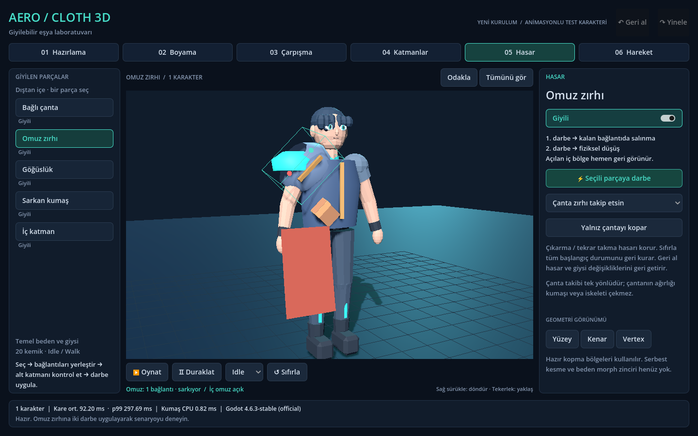

# AeroCloth3D · Giyilebilir eşya laboratuvarı

Boş depodan yeniden kurulan **0.1-rebuild prototipi**. Önceki 0.9 sürümünün
kurtarıldığı anlamına gelmez. Animasyonlu gerçek bir iskelet/mesh üzerinde,
hazırlanmış bağlantı kopması ve alt katmanın geri açılması gösterilir.



## Çalıştırma

1. Godot ile `project.godot` dosyasını aç; GLB importunun tamamlanmasını bekle.
2. F6 ile `demo/CharacterWardrobe.tscn` sahnesini veya F5 ile projeyi çalıştır.
   Eklenti menüsü: **Project → Tools → AeroCloth3D · Open Character Lab**.
3. Omuz zırhını seç, **Hasar → Seçili parçaya darbe** düğmesine iki kez bas.
4. İlk darbede tek bağlantıda sarkar ve iç omuz görünür. İkinci darbede düşer.
5. Çanta için takip / ana parça düşünce ayrılma seç; istersen çantaya ayrıca vur.
6. **Sıfırla** giysileri onarır ve animasyonu başa alır; hazırlama ayarları korunur.

Sağ tuş sürükleme kamerayı döndürür; tekerlek yaklaşır. **Odakla** seçili bölgeyi
yakın gösterir. **Hareket** bölümünde bir veya üç karakterle deneyebilirsin.
Duraklat, animasyonu durdurur; fizik devam eder.

**Hazırlama** bölümünde bağlantıların X/Y/Z konumları ve alt bölge ilişkisi
değişir. **Ayarı kaydet**, bağlantıları, kumaş boyamasını ve aksesuar kuralını
Godot kullanıcı klasöründeki `wearable-profile.json` dosyasına yazar. Dosya yolu
durum satırında gösterilir. Kaydı yüklemek hasarı onarmaz.

**Boyama → Sarkan kumaş**: sabit / kısmi / serbest seçip sol tuşla boya.
Bir fırça hareketi tek Undo adımıdır. Geri al / Yinele, Ctrl+Z / Ctrl+Y çalışır.
Giysi çıkarıp takma, bağlantı düzenleme ve hasar da geri alınabilir.

## Doğrulanan kapsam

- 20 kemikli yeni test karakteri; Idle ve Walk döngüleri.
- Vücuda yakın bölgesel iç katman, göğüslük, iki bağlantılı omuz zırhı,
  99 noktalı CPU kumaş parçası, bağımsız bağlantılı çanta.
- Animasyon kemiğine bağlı zırh, kalan bağlantıda kontrollü sarkma,
  son bağlantıda önceden hazırlanmış RigidBody3D ile zemine düşüş.
- Hasarın eşya üzerinde korunması; kesin örtülen iç bölgelerin görünürlük
  kontrolü; gizli karakterlerin ve çıkarılan kumaşın hesaplamasının durması.
- Seçime göre araçlar, giysi çıkarma/takma, bağlantı noktaları, yüzey/kenar/vertex,
  boyama, Undo/Redo, ayar dosyası ve üç karakter için ölçüm.

Bu, keyfi varlıkları otomatik hazırlayan tam bir giysi editörü değildir.
Kumaş çözümü ve askıda zırh hareketi prototiptir. Askıdaki zırh ve çanta karakteri
geri itmez. Genel beden/giysi teması, kumaştan serbest kesme, morph zinciri,
Blender eklentisi, üçgen kumaş socket'i ve çantanın ağırlığının kumaşı çekmesi
henüz uygulanmadı. Blender'ın yerine modelleme/rig aracı kurulmadı.

## Sürümler ve varlıklar

**Test edilen:** Godot 4.6.3, Blender 4.3.2. Kullanıcının hedefi Godot 4.7.2 ve
Blender 5.2.3; bu hedef sürümler burada çalıştırılmadı.

Özgün Cyberstyle arşivi bu ortamda bulunamadı. Gösterilen karakter yeni üretilmiş
bir test varlığıdır; özgün karakter değildir. Düzenlenebilir `.blend`, `.glb`,
Python üreticisi ve [kaynak/lisans bilgileri](demo/assets/recovery_character/README.md)
pakete dahildir. Doğrudan `.blend` importu kapalı; Godot GLB kullanır.

## Test ve ölçüm

```bash
bash scripts/validate.sh
bash scripts/benchmark.sh headless
bash scripts/benchmark.sh rendered
python3 scripts/package.py
```

`GODOT_BIN` ile farklı Godot çalıştırılabilir dosyası seçilebilir. Render testi
masaüstü/X11 oturumu ister. Her rapor 120 kare ısıtma sonrası 600 kare kaydeder;
üç tur ilk kopma + düşme, olaydan önce iki ve sonra beş kareyi ayrı saklar.

Kararlar: [mimari](docs/ARCHITECTURE.md) · [kurtarma kaydı](docs/RECOVERY.md) ·
[doğrulama](docs/VERIFICATION.md) · [ölçümler](docs/PERFORMANCE.md) · [kalan işler](docs/NEXT.md).

Görseller: [sağlam](artifacts/lab-intact.png) · [tek bağlantı](artifacts/lab-hanging.png) ·
[kopmuş](artifacts/lab-detached.png) · [üç karakter](artifacts/lab-three.png).
