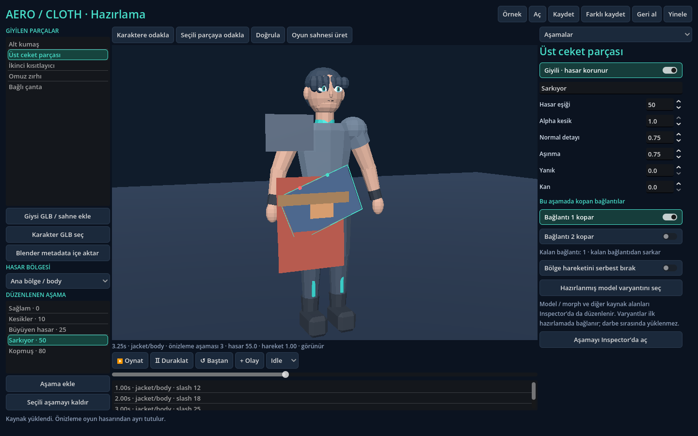

# Animasyon, sarkma ve kopma doğrulaması · 2026-11-05

## Varlık olmadan hangi işler ilerleyebilir?

Mevcut örnek gerçek bir iskelet ve Idle/Walk animasyonları içerir. Ayrı hazırlanmış
kumaş panelleri, düşük çözünürlüklü proxy, iki katman kısıtlayıcısı, omuz zırhı ve
yüzeye bağlı aksesuar; durum, bağlantı, kayıt ve editör davranışını doğrulamak için
yeterlidir. Yeni üretim giysisi beklemek bu işlerin önkoşulu değildir.

Bu testler üretim giysisinin oturuşunu, ağırlık boyalarını, koltuk altı/eklem
katlanmasını, UV dikişlerini, yırtık kenarının sanat kalitesini veya karmaşık
giysilerin iç içe geçmemesini kanıtlamaz. Bunlar temsilî gerçek giysiyle ayrı
kabul adımıdır. Rastgele üretim modeli ya da otomatik kusursuz fit eklenmedi.

## Düzeltilen sorunlar

- Animasyonu elle ilerletme/geri sarma sırasında BoneAttachment güncellemesi
  erteleniyordu. Hazırlanmış bağlantılar artık yeni kemik pozuyla aynı adımda
  güncellenir. Omuz zırhı hareket eden Walk kemiği üzerinde test edilir.
- Kopan parça yalnız bağlantı noktasının doğrusal hızını alıyordu. Artık
  animasyon dönüşü, sarkmanın teğetsel hızı ve dünya uzayındaki açısal hız da
  aktarılır. Darbenin merkezi impulsu kütleye bölünerek bu hıza hemen eklenir.
  Görsel ve rigid body önceden ayrılmış nesneler olarak tekrar kullanılır.
- Sarkmanın sınır açısında engellenen dışa doğru hız sıfırlanır; durmakta olan
  parça son bağlantı koptuğunda birikmiş görünmeyen hızla fırlamaz.
- Elle önizleme, kopma hızını ve dönmeyi devam ettirir; güncel düşme hızı kayıt
  durumuna da yazılır. Önizlemenin basit zemin modeli genel fizik dünyası değildir.
- Duraklatılmış kayıt yüklemede önce bütün kumaş yüzeyleri, sonra aksesuar
  bağlantıları, ardından parça durumları yüklenir. İlk fizik karesini beklemeden
  çanta doğru yerdedir. Yüklemenin hemen ardından gelen darbe de kaydedilmiş
  animasyon hızını devralır. Yeni hız alanları olmayan eski kayıtlar kabul edilir.
- Aşamanın kopacak bağlantıları artık Hazırlama bölümüyle aynı numaralara sahip
  kutucuklardır. Geçersiz bağlantı seçimi reddedilir; düzenleme tek Undo işlemidir.
  Proxy kumaşı için sert parça bağlantısı varmış gibi araç gösterilmez.

## Tekrar doğrulama

Son koşu: 690 başsız kontrol ve 157 gerçek OpenGL görüntüleme/arayüz kontrolü,
sıfır hata. Bu toplamlar birbirinden bağımsız benzersiz test sayısı değildir;
görüntüleme koşusu bazı mantık kontrollerini tekrar eder. Yeni testler içinde
19 hız/geçiş ve 40 oyun API'siyle yaşam döngüsü kontrolü bulunur. Eklenti ayrıca
boş projede içe aktarma, sahne üretme ve ayrı oyun sürecinde darbe testini geçti.
Blender kodu değiştirilmedi; önceki 40 kontrol bu çalışmada tekrar koşulmadı.

`scripts/validate.sh`, yeni `test_attachment_continuity.gd` ve
`test_damage_lifecycle.gd` testlerini de çalıştırır. İkinci test aşama önizleme
kısayolları yerine oyunun `apply_hit` API'sini kullanır:

Walk → materyal hasarı → ilk bağlantı kopması → sarkma → alt katmanın açılması →
diğer katmanın kısıtının korunması → kumaşın serbestleşmesi → duraklatılmış JSON
kaydı/yükleme → son bağlantı → düşme → aksesuarın kendi darbesiyle kopması → reset.

Hasar, kopma ve katman durumu mantıkta hemen değişir; kozmetik harita işçileri
ayrıdır. Testlerde bu zinciri izole etmek için senkron maskeler kullanılır;
normal oyun yolundaki asenkron maskeler mevcut ayrı regresyon testleriyle korunur.

Ölçüm ortamı Godot 4.6.3 ve llvmpipe yazılımsal OpenGL'dir. Hedef Ryzen 5 1600 /
GTX 1650 4 GB / 16 GB RAM cihazında test yapılmadı. Jolt'a özel fizik doğrulaması
ve hedef Godot 4.7.2 / Blender 5.2.3 uyumluluğu bu çalışmanın sonucu değildir.

## Üç karakter ölçümü

Son değişikliklerle tekrar edilen ölçüm:
[`continuity-benchmark-rendered.json`](../artifacts/continuity-benchmark-rendered.json).
120 ısınma + 600 ölçüm karesi, 12 olayda üç karaktere eşzamanlı altı eşya darbesi;
test süreçleri kapatıldıktan sonra tek başına çalıştırıldı.

| Ölçüt | ms |
|---|---:|
| Ortalama kare | 35,299 |
| p99 kare | 68,952 |
| En uzun kare | 80,209 |
| Altı darbeyi işleyen en uzun çağrı | 10,813 |
| Altı kozmetik maskenin yayınına kadar en uzun gecikme | 336,814 |

Ölçüm sonunda bekleyen maske işi yoktur. Darbeler bilinen UV koordinatlarını
kullanır; dünya temasını UV'ye eşleştirme maliyeti bu çağrılara dahil değildir.
Bu tablo llvmpipe yazılım renderer'ının CPU yükünü içerir; hedef PC için 60 FPS
onayı değildir. Önceki 0.3 ölçümleri `authoring-benchmark-*.json` olarak korunur.

