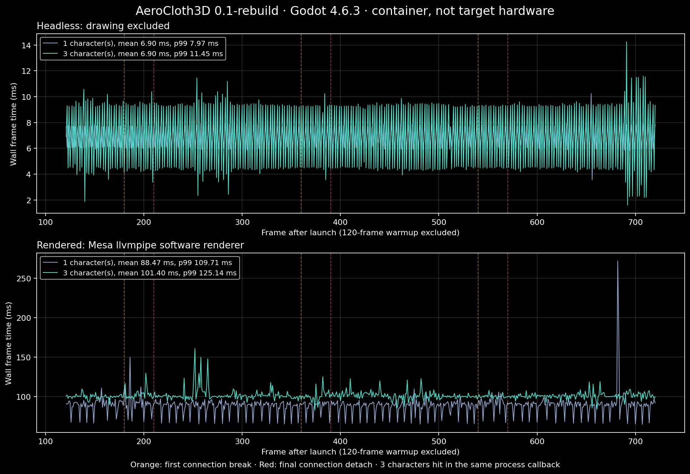

# Ölçüm · 2026-11-02

**Bu, hedef oyun donanımının performans sonucu değildir.** Render edilen test
GPU yerine Mesa **llvmpipe (LLVM 19.1.7, 256 bits)** yazılım renderer'ı kullanır.
Bu ortamda çizimli laboratuvar yavaştır; bu sonuçtan 60 FPS uyumluluğu çıkarılamaz.

Godot 4.6.3 official, GL Compatibility, Linux, görünen 3 CPU,
Intel Xeon Platinum 8573C. Pencere 1440×900; 3D alt viewport **840×554**.
Son ölçümler doğrulama testlerinden sonra, başka Godot testi/renderer çalışmadan
sırayla alındı. Ortam paylaşımlı/sanallaştırılmıştır; dış scheduler değişkenliği
devam eder. Otomasyon sırasında kamera ve giysi ayarları değiştirilmedi.

## Yöntem

- Her koşulda 120 süreç karesi ısıtma, ardından 600 kare örnek.
- Idle başlangıcından sonra Walk oynar; bütün görünür karakterler aynı sahnede.
- Aynı süreç callback'inde bütün görünür omuzlara darbe: kare 180/360/540 ilk
  bağlantı, 210/390/570 son bağlantı. Üç ilk kopma ve üç düşme olayı.
- Aralarda önceden yaratılmış parçalar onarılır. Mesh kesme veya hasar anında
  rigid-body/shape yaratma yapılmaz. Her karakterin kumaşı çalışır; çanta takip eder.
- `call_ms` darbe işlemi **ve arayüz state signal güncellemeleri** süresidir.
  Tam fizik, render veya yalnız core çözücüsü süresi olarak okunmamalıdır.
- Her olay için önceki iki, olay kaydı ve sonraki beş wall-frame saklanır.
  `following_frame_ms` çağrının sonraki kareye etkisini kapsar; renderer/işletim
  sistemi zamanlamasını olay maliyetinden tek başına ayırmaz.
- Headless ölçüm çizim ve GPU skinning içermez. ~6.9 ms ortalama engine/headless
  zamanlamasıyla sınırlıdır; saf CPU hesaplama süresi veya GPU FPS tahmini değildir.

## Sonuçlar (ms)

| Koşul | Karakter | Kare ort. | p99 | Tüm test tepe | Hasar çevresi tepe | Darbe çağrısı tepe |
|---|---:|---:|---:|---:|---:|---:|
| Headless | 1 | 6.902 | 7.974 | 10.247 | 8.121 | 0.884 |
| Headless | 3 | 6.904 | 11.454 | 14.249 | 10.388 | 2.580 |
| Yazılım render | 1 | 88.467 | 109.712 | 271.975 | 113.234 | 1.950 |
| Yazılım render | 3 | 101.401 | 125.135 | 160.874 | 116.698 | 2.712 |

Üç karakterde yalnız son bağlantı/düşme olaylarının çevresindeki en yüksek kare
**108.547 ms**; ilk kopma ve düşme birlikte bakıldığında **116.698 ms**.
Bu kısa örnekte olay çevresi genel p99'dan yüksek değildi. Üç olaydan hareketle
üretim sahneleri için takılma olmayacağı sonucu çıkarılamaz.

Kumaşın en son fizik adımındaki ölçülen script süresinin örnek ortalaması:
headless 1/3 karakterde **0.805 / 2.477 ms**, yazılım render'da **0.926 / 2.449 ms**.
Yavaş render sırasında tek süreç karesinde birden fazla fizik adımı çalışabilir;
bu değerler kare başına toplam kumaş maliyeti değildir. Son adımı örnekler.
Yalnız 99 noktalı bu patch için geçerlidir; daha büyük giysilere genellenmez.

Godot process/physics monitor ortalamaları da ham JSON'da bulunur. Engine
monitor örnekleme/zamanlama kapsamı wall-frame ve yerel script kronometresiyle
aynı değildir; toplanıp bütçe çıkarılmamalıdır. Draw/skinning/morph/memory için
ayrı GPU/CPU maliyet ayrıştırması yapılmadı. Morph zaten uygulanmış değildir.



## Tekrar üretim

```bash
bash scripts/validate.sh
bash scripts/benchmark.sh headless
bash scripts/benchmark.sh rendered
python3 scripts/plot_benchmark.py  # isteğe bağlı; matplotlib gerekir
```

Ham veriler: `artifacts/benchmark-{headless,rendered}-{1,3}.json`, 600'er wall
kare ve olay pencereleri. Özet: `artifacts/benchmark-summary.json`. Grafik SVG ve
PNG olarak dışa aktarılmıştır. Daha önceki karaktersiz veya testlerle çakışan
deneme çıktıları nihai raporların yerine kullanılmadı.

Hedef FPS ve en düşük donanım belirlenince bu aynı senaryo gerçek GPU üzerinde
yeniden ölçülmeli. Region mesh / indeks cache / compact vertex karşılaştırması
henüz yapılmadı. Ayrıca mevcut kumaş prototipinin her fizik adımında küçük
ArrayMesh yenilemesi, sabit GPU buffer güncellemesiyle karşılaştırılmalı.
